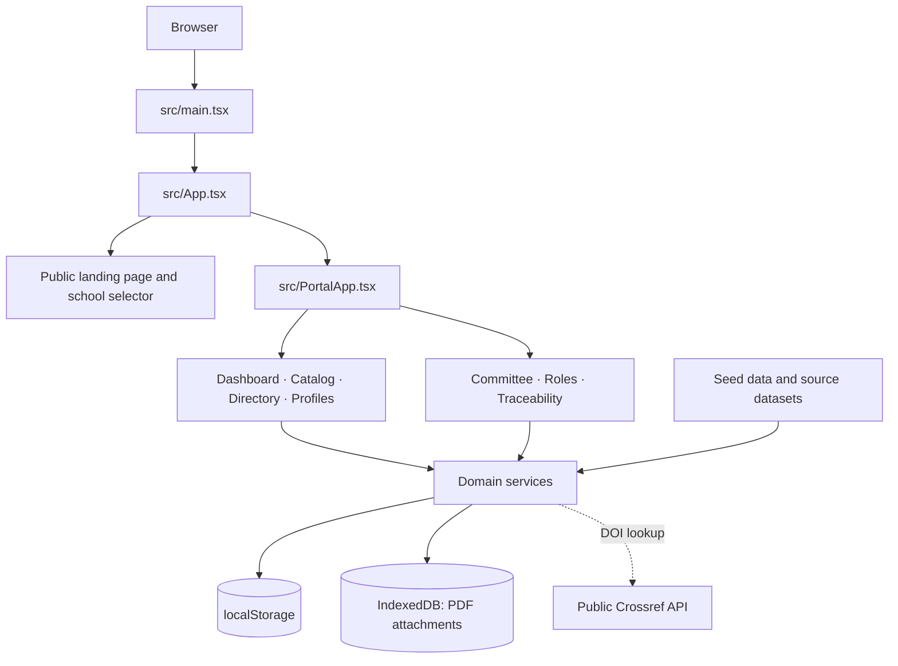

# Architecture

## Overview

The application builds to a static website. React manages the UI and application state; services under `src/services/` read and write browser data. There is no application server, first-party API, remote database, or cross-user synchronization.

Crossref is queried only when a DOI is resolved outside the small local example catalog and the browser is online. It is not a first-party API and does not synchronize saved records.

## Startup and navigation

1. `src/main.tsx` imports global styles, prepares school logos, and mounts React.
2. `src/App.tsx` selects the public landing page or a school portal. It also manages school selection, browser history, and transitions between schools.
3. `src/PortalApp.tsx` initializes the session and loads local records. It renders the active tab and connects UI actions to services.
4. `src/components/layout/Header.tsx` provides navigation, access controls, notifications, and actions available to the current profile.

Navigation state uses the browser History API; the project does not use an external router. The landing page has separate touch-oriented and desktop presentations in `TouchResearchStage.tsx` and `ResearchStage.tsx`.

## Main modules

| Path | Responsibility |
| --- | --- |
| `src/components/institutional/` | Public landing page, school selector, visual transition, and entry loading. |
| `src/components/dashboard/` | Metrics, featured publications, charts, and school information. |
| `src/components/catalog/` | Search, filters, record details, and project tracking. |
| `src/components/directory/` | Researcher directory and faculty profiles. |
| `src/components/auth/` | Visitor access, sign-in, and demo registration. |
| `src/components/register/` | Publication and project registration/editing. |
| `src/components/reviewer/` | Queue for pending records. |
| `src/components/profile/` | Faculty/student profile settings and student collaborations. |
| `src/components/roles/`, `traceability/` | Demo tools for roles and project traceability. |
| `src/constants/` | School configuration, official research lines, demo accounts, and seed records. |
| `src/types/index.ts` | Domain object contracts. |

## Services

- `storage.ts`: loading, serialization, initial data, and local ECMC migration. Some multi-key writes restore prior values if saving fails.
- `authService.ts` and `roleService.ts`: locally stored demo sessions, credentials, and roles.
- `productService.ts`: visibility, duplicate checks, record creation, correction of observed records, review, notifications, and project tracking.
- `metricsService.ts` and `productPresentation.ts`: metrics and shared product-presentation rules.
- `doiService.ts`: DOI normalization and Crossref metadata lookup; also contains simulated examples.
- `ecmcResearchLineDictionary.ts`: temporary research-line suggestions for imported ECMC publications.
- `pdfExtractorService.ts`: basic file validation and simulated preliminary metadata; it is not a complete bibliographic parser.
- `articleAttachmentService.ts`: stores PDF blobs in local IndexedDB.
- `exportService.ts` and `printDocument.ts`: CSV/Excel downloads and browser printing.

## Record visibility

The product service applies these UI rules:

- Visitors see records whose status is `verified`.
- Faculty see verified records and their own records in any status; they can register publications and projects.
- The Scientific Committee has a review workflow but cannot register research output from that view.
- Developers have review, traceability, and role-management tools.
- Students have a profile and collaboration area; they cannot register research output.

These rules shape the interface but are not server-side authorization. See [Security and limitations](security-and-limitations.md).

## Styles and assets

Global styles are in `src/index.css`; portal styles are in `src/portal.css` and `src/mobile-portal.css`. School configuration lives in `src/constants/schools.ts`, with asset maps under `src/assets/`. Vite assets use `import.meta.env.BASE_URL`, which is required for the GitHub Pages project path.
